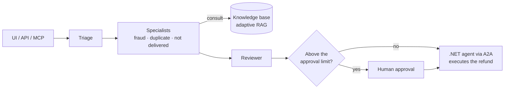

# card-dispute-ai

An end-to-end AI analyst for credit-card disputes: it classifies the dispute, consults regulations and policies, investigates the customer's history and proposes a decision with cited sources, escalating to a human above the approval limit.
Each module demonstrates one capability expected from a production AI system (retrieval, multi-agent orchestration, evaluation, security and operations), always backed by measured numbers.

## Stack

Python 3.12 · uv · LangGraph · FastAPI · Pydantic · Postgres + pgvector · Kafka · RabbitMQ · Redis · OpenTelemetry + Langfuse · Streamlit · .NET 10 (A2A)

## Design principles

- **The agent proposes, the domain decides:** the LLM returns a structured proposal, and the `Dispute` aggregate enforces the business invariants.
- **DDD + light CQRS + vertical slices:** commands go through the aggregate, queries map it to their own results, and each use case lives in its own slice.
- **Architecture contracts enforced in CI:** import-linter breaks the build if the domain imports a framework or one slice imports another.

## Run it

With Docker running:

```bash
docker compose up --build
```

This starts Postgres, applies the migrations, loads the synthetic data (52 customers, 1,068 card transactions, 300 open disputes) and serves the API. Open http://localhost:8000/docs and try:

- `GET /disputes`: the dispute queue, oldest first
- `POST /disputes`: the example body opens a dispute for a duplicate charge
- `GET /disputes/{id}`: one dispute, with the merchant and the card it was charged on

Without Docker, the API keeps data in memory:

```bash
uv sync
uv run pytest
uv run uvicorn dispute_analyst.main:app --reload
```

All data is synthetic, generated with a fixed seed by [`scripts/seed.py`](scripts/seed.py). [`evals/datasets/disputes_v1.jsonl`](evals/datasets/disputes_v1.jsonl) records the expected decision for each of the 300 disputes and the data that proves it; it is the ground truth for the evals in module 6.

## How it works



## Modules

| Module | What it proves | Status |
| --- | --- | --- |
| 1. Core and infrastructure | DDD domain, swappable LLM provider and one-command infrastructure | 🚧 |
| 2. Knowledge base and ingestion | A realistic regulatory corpus with a ground truth for retrieval | ⬜ |
| 3. RAG Lab — ranking benchmark | Retrieval strategy chosen by benchmark, not opinion | ⬜ |
| 4. Adaptive RAG and GraphRAG | Spending more only on the questions that need it | ⬜ |
| 5. Supervisor with human approval | Multi-agent flow with human-in-the-loop and durable checkpoints | ⬜ |
| 6. Evals in CI | Quality as a merge criterion | ⬜ |
| 7. Deterministic vs autonomous vs hybrid | When to use a workflow and when to use an agent | ⬜ |
| 8. Guardrails and LGPD | Safety in a regulated context: PII masking and prompt-injection defense | ⬜ |
| 9. Observability, cost and cache | Operating the system with data: traces, cost per dispute, semantic cache | ⬜ |
| 10. Messaging, resilience and durable execution | Surviving failures without losing work or duplicating effects | ⬜ |
| 11. MCP server | Exposing the analyst to any MCP client | ⬜ |
| 12. .NET agent via A2A | Interoperability across Python and .NET agent stacks | ⬜ |

🚧 in progress · ⬜ not started

## Read more

- [docs/SCOPE.md](docs/SCOPE.md): full scope, what each module delivers and when it counts as done
- [docs/KICKOFF.md](docs/KICKOFF.md): summary of the decisions taken at kickoff
- [AGENTS.md](AGENTS.md): architecture rules, dependency contracts, commands and conventions

## Articles

The series starts with module 1.
